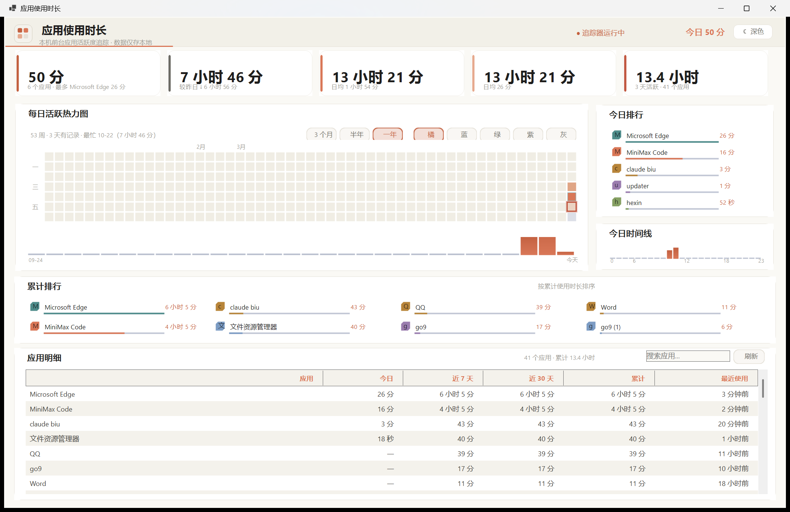
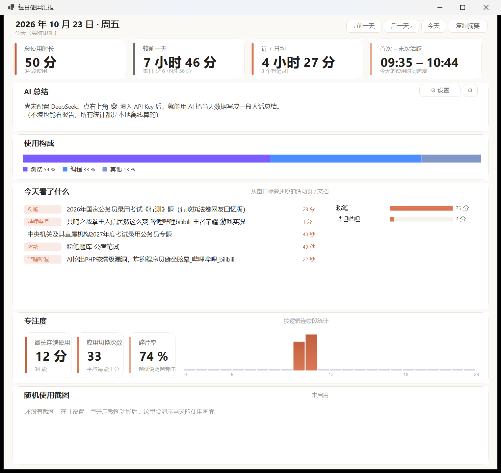

# 应用使用时长 · 本机使用追踪与热力图

统计这台电脑上**每个软件的使用时长**，用 GitHub 贡献热力图的方式展示每日活跃度，
并生成一份可读的**每日使用汇报**。

**原生 Windows 程序（单文件 EXE），不依赖浏览器、不联网（除你主动开启的 AI / 截图存档）、无账号。**



---

## 快速开始

| 想做什么 | 怎么做 |
|---|---|
| 打开主界面 | 双击 `dist\AppUsage.exe` |
| 后台常驻（不占屏幕） | `AppUsage.exe --tray`（开机自启用的就是这个） |
| 看每日汇报 | 主界面顶栏「📋 日报」按钮，或点热力图任意格子 |
| 控制台菜单 | 双击 `AppUsage.cmd` |
| 改设置 | 日报页右上角 ⚙（DeepSeek / GitHub 私有仓 / 截图） |

---

## 每日使用汇报

顶栏「📋 日报」打开独立窗口，可以看**今天或任意历史日**（‹ 前一天 / 后一天 › / 今天）。



六块内容：

| 区块 | 内容 |
|---|---|
| 概览 | 总使用时长、较前一天、近 7 日均、首次–末次活跃 |
| AI 总结 | 用 DeepSeek 把当天数据写成 3~5 句人话（需自备 key） |
| 使用构成 | 按应用分类的占比（编程 / 办公 / 沟通 / 娱乐 / 浏览 / 学习 / 其他） |
| 今天看了什么 | **从窗口标题还原出的活动页 / 文档**，带站点徽标；右侧是站点分布 |
| 专注度 | 最长连续使用、应用切换次数、碎片率、24 小时活跃条 |
| 随机使用截图 | 当天使用画面缩略图，点击在 GitHub 打开原图 |

### 网页名是怎么记下来的

浏览器的窗口标题是 `粉笔课堂 和另外 2 个页面 - 个人 2 - Microsoft Edge` 这种脏格式。
程序在**读取时**（不是采集时，所以零开销、旧数据立刻可用）做三步：

1. **清洗** —— 去零宽 / 不可见字符，折叠空白
2. **剥后缀** —— 依次剥掉 `和另外 N 个页面`、`- 个人 N`、`- Microsoft Edge` 等
   ⇒ 剩下的就是**活动标签页的真实标题**（`粉笔课堂`、`判断-模块检测`…）
3. **认站点** —— 用「标题关键词 → 域名」表匹配（`config.json` → `site_hints`，可改）
   ⇒ `粉笔` / `专项智能练习` / `单题批改` → `fenbi.com`

**只记站点域名，不记完整 URL**，隐私暴露面不比之前更大（窗口标题本来就在记）。
匹配不到就显示「未识别站点」，**绝不瞎猜**。

### 专注度是这么算的

日志每 20 秒落盘一行，所以**同一段长时间使用会被切成很多 20 秒的块**。
程序先把「同应用 + 间隔 ≤ 60 秒」的相邻块**合并成逻辑连续段**，再算：

- 最长连续使用 = 最长的合并段
- 切换次数 = 合并段的段数 − 1
- 碎片率 = 1 − 最长连续 / 总时长

> 直接拿日志行数当切换次数是错的（会把 20 秒落盘算成切换）。

---

## 两套皮肤

顶栏右上角 **☀ 浅色 / ☾ 深色** 一键切换，选择记在 `data\ui.json`，下次启动自动恢复。**默认浅色。**

- **浅色 —— Claude 风格**：暖米白底 `#FAF9F5`、陶土橘强调色 `#D97757`、圆角柔和、无辉光
- **深色 —— 女神异闻录 V 风格**：深午夜蓝底、电光蓝 `#2E6FE0` + 青色 `#45B8E0`、
  切角面板、斜切平行四边形按钮、霓虹辉光

> 改配色只需要动 `native\Ui\Theme.cs` 顶部的常量。

---

## AI 总结（可选）

日报页 ⚙ → **DeepSeek** 段填 API Key，保存后就能用。

- 端点 `https://api.deepseek.com`（OpenAI 兼容），**模型默认 `deepseek-v4-pro`**（当前最新）
  ；`deepseek-v4-flash` 是省钱档
  （⚠️ 旧的 `deepseek-chat` / `deepseek-reasoner` 已于 2026-07-24 弃用，**不能用**）
- **默认不联网**：不填 key 就完全没有网络行为
- 请求体里只有**归纳后的统计数字**（总量、分类占比、TOP 应用名、站点名、专注度），
  **不发** exe 路径、完整 URL、截图
- `include_topics` 打开时会额外发**最多 8 条**清洗后的页面标题（可在设置里关掉）
- key 存本地 `config.json`，**不写进任何日志**
- 失败（401 / 429 / 超时）会显示明确原因 + 重试按钮，**不影响报告的其它部分**

---

## 随机使用截图 + 私有 GitHub 存档（可选，默认关闭）

日报页 ⚙ → **随机使用截图** 段开启。

- 每 20 分钟抓一张**当前前台窗口**（不是全屏）
- 抓图链路：`PrintWindow` →（Chromium 窗口常返回黑图）→ 黑图检测 → 降级 `BitBlt` 屏幕区域
- 全图（1280 宽，JPEG q60，约 150 KB）**base64 上传到你的 GitHub 私有仓库**：
  `PUT /repos/{owner}/{repo}/contents/shots/YYYY/MM/DD/HH-mm-ss_<app>.jpg`
- 上传成功 → 本地全图立即删除，**只留 320 宽的缩略图**（约 20 KB）供日报即时显示
- 上传失败 → 全图进 `data\shots\outbox\` 队列，下次启动自动补传
- 每次上传是一个 commit ⇒ **git 历史天然永久保留**，本地不需要任何清理逻辑

**限额与保护**：每天最多 8 张；outbox 累计超过 200 MB 丢最旧的；
**磁盘剩余不足 1 GB 自动停拍**（当前 D 盘只剩 5.3 GB，这条很关键）。

**隐私（务必看清）**：
截图可能包含屏幕上的聊天 / 邮件等敏感内容，而且**会上传到 GitHub 私有仓库**——
私有仓库只有你能看到，但**这仍然是上传到云端**。所以默认关闭，且可按应用排除
（默认已排除 `wechat/qq`）。**截图永远不会发给 DeepSeek。**

> 凭据建议用 **fine-grained PAT**（只授权那一个私有仓库的 Contents 读写），
> 比 classic PAT 的 `repo` scope 权限小得多。

---

## 资源占用（2026-10-23 实测，本机 150% 缩放）

| 场景 | 内存（私有） | CPU | 线程 |
|---|---|---|---|
| 托盘常驻 | **49.5 MB** | **0.07 %** | 10 |
| 主界面打开 | 约 86 MB | 约 0.2 % | 20 |

> Python 网页版虽然自身只要 10 MB，但**必须开浏览器**——一个 Edge / Chrome 窗口额外占
> 100~300 MB。原生 EXE 没有任何浏览器进程，**总占用反而更低**。

**一条踩过的坑**：曾用「透明容器 + 实时重绘渐变背景」做深色底，CPU 直接从 0.16% 飙到
**2.8%**——透明控件每次重绘都会让父层重画背景区域，渐变位图还要整块缩放。
正确做法是**顶层容器用不透明背景**，渐变改成预生成的小位图。

---

## 工作原理

`native\Core\Tracker.cs` 每秒做三件事：

1. `GetForegroundWindow()` 取当前前台窗口 → 进程 PID → `QueryFullProcessImageNameW` 取 exe 路径
2. `GetLastInputInfo()` 判断你多久没碰键鼠了——**超过 `idle_seconds`（默认 90 秒）就不计任何时长**，
   避免人走开后把时长算到某个程序头上
3. 前台应用没变就继续计时；变了就把上一段追加写进日志。跨零点的片段**按自然日拆开**

数据落在 `dist\data\usage.log`（纯文本 TSV，追加写）。仪表盘**只读新增行**，
并压成两层聚合：

```
(天 → 总量 / 各应用 / 各小时 / 主题 / 站点 / 段序列)  +  (应用 → 累计)
```

即使日志有几十万行，内存里也只有几万条聚合记录。

### 应用归类

- 主键是 **exe 文件名**（`chrome.exe` → `chrome`），同一软件的多个窗口会合并统计
- 显示名：`config.json` → `app_names`
- 分类：`config.json` → `app_categories`（未归类的进「其他」，占比合计恒为 100%）

---

## 配置

`config.json`（EXE 会依次找 `dist\config.json`、项目根 `config.json`、`data\config.json`）：

| 键 | 默认 | 说明 |
|---|---|---|
| `poll_interval` | `1.0` | 采样间隔（秒） |
| `idle_seconds` | `90` | 空闲多久算「人不在」，不计时长 |
| `min_span_seconds` | `2.0` | 短于这个长度的片段直接丢弃 |
| `flush_interval` | `20.0` | 当前片段最长多久落一次盘 |
| `excluded_exes` | `[]` | 不统计的 exe 名 |
| `app_names` | `{}` | exe 名 → 显示名 |
| `app_categories` | `{}` | exe 名 → 分类 |
| `site_hints` | `{}` | 标题关键词 → 站点域名 |
| `site_names` | `{}` | 域名 → 中文显示名 |
| `ai` | 见上文 | DeepSeek 配置 |
| `shots` | 见上文 | 截图 + GitHub 存档配置 |

---

## 命令行

```
AppUsage.exe              打开主界面
AppUsage.exe --tray       只在托盘常驻（开机自启用这个）
AppUsage.exe --data <目录>  指定数据目录
AppUsage.exe --dump <yyyy-MM-dd>  把某天的日报导出成 data\report-dump.txt（调试用）
AppUsage.exe --test-shot  抓一张当前前台窗口的图（自测截图链路用）
```

---

## 源码结构

```
native/
├─ Program.cs              入口（--tray / --data / --dump / --test-shot）
├─ Core/
│  ├─ NativeMethods.cs      Win32 P/Invoke：前台窗口 / 进程路径 / 空闲 / 抓屏
│  ├─ Tracker.cs            后台采集线程，追加写日志
│  ├─ Store.cs              增量读取 + 聚合
│  ├─ TopicParser.cs        窗口标题清洗 / 剥后缀 / 认站点
│  ├─ CategoryMap.cs        应用分类 + 站点关键词表
│  ├─ ReportModel.cs        日报数据模型
│  ├─ ReportBuilder.cs      从 Store 装配日报（纯函数、离线）
│  ├─ Screenshotter.cs      抓窗 + JPEG 编码（含黑图检测与降级）
│  ├─ ShotService.cs        截图后台线程 + 限额 + outbox 重试
│  ├─ ShotUploader.cs       GitHub Contents API 存档
│  ├─ ShotIndex.cs          列出当天缩略图 + 算 GitHub 原图链接
│  ├─ AiClient.cs           DeepSeek 调用
│  ├─ Config.cs / AppPaths.cs / UiPrefs.cs / Models.cs
├─ Ui/
│  ├─ MainForm.cs           主界面
│  ├─ ReportForm.cs         日报页
│  ├─ SettingsForm.cs       设置页
│  ├─ HeatmapControl.cs     自绘热力图
│  ├─ ReportWidgets.cs      构成条 / 主题列表 / 站点列表
│  ├─ Widgets.cs            统计卡 / 排行 / 时间线 / 趋势条
│  ├─ ShotGrid.cs           截图缩略图网格
│  ├─ SmtControls.cs        斜切按钮 / 斜体文字
│  ├─ Card.cs               卡片容器 / 顶栏
│  └─ Theme.cs              配色 + 几何 + DPI 缩放
└─ tools/                   开发自检脚本（抓图 / 模拟点击 / 窗口枚举）
```

> **DPI 说明**：PerMonitorV2 下 WinForms **不会**自动缩放手工布局（`AutoScaleFactor` 恒为 1），
> 所以设计常量统一按 96 DPI 编写，绘制时乘 `Dpi.Scale`（本机 150% 缩放 → 1.5）。
> 字体点数**不要乘**（GDI+ 会按 DPI 自动换算成像素），只有空间常量要乘。

---

## 已知边界

- 只能统计**前台**应用。最小化到托盘的后台程序不计入。
- 全屏独占的游戏能拿到前台窗口，但部分游戏会自己清空窗口标题。
- 远程桌面 / 锁屏期间视同空闲，不会计时长。
- 换了 exe 名就认成新应用，升级改名的软件历史会断档。
- 纯前台轮询，秒级精度约 ±1 秒。

---

## 附：早期网页版（已归档）

`legacy-web/` 是最初用 Python + 本地网页实现的版本（同样是纯本地）。功能基本一致，
但需要开浏览器、常驻一个 Python 进程，现已不作为主力。

```powershell
cd legacy-web
python tracker.py        # 采集
python server.py          # 起本地服务
```

> **改 `.ps1` 脚本后记得跑一次 `python scripts\fix-encoding.py`**：
> Windows PowerShell 5.1 读取没有 BOM 的 `.ps1` 会按 GBK 解码，中文会变乱码甚至语法错误。
